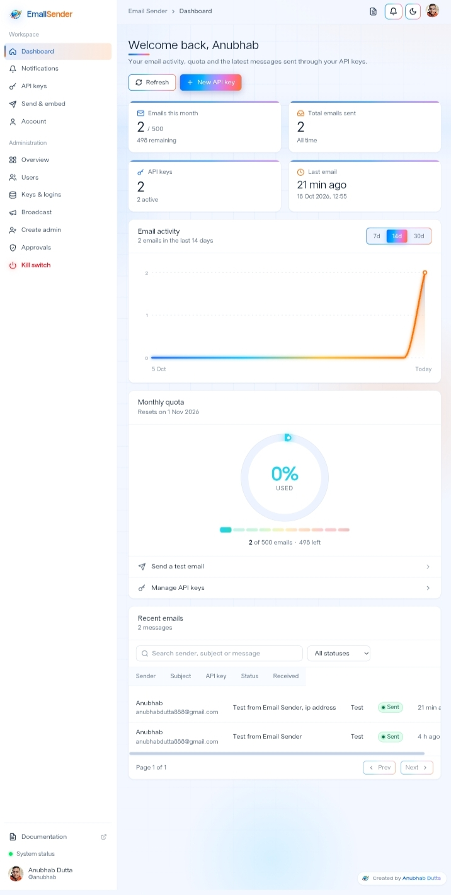
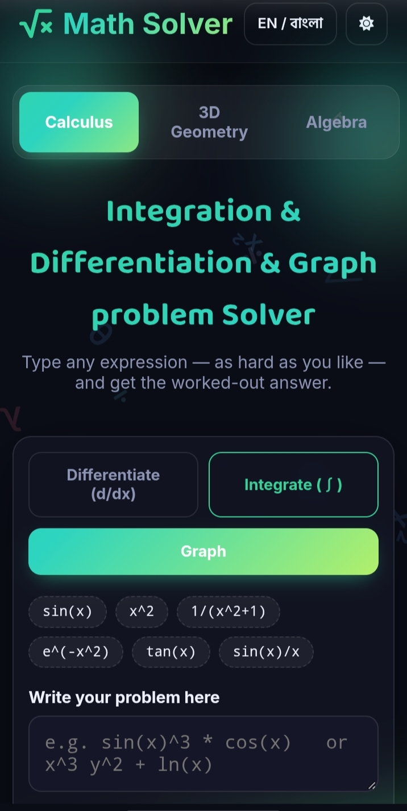
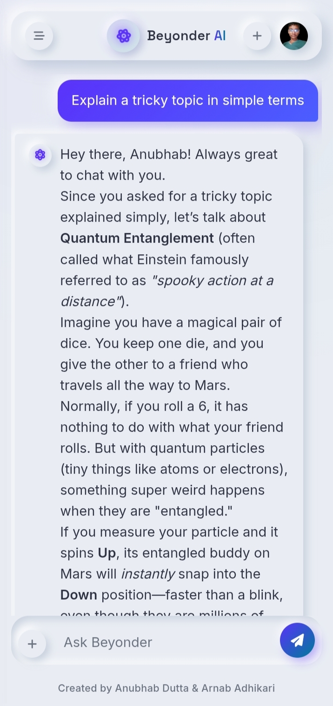
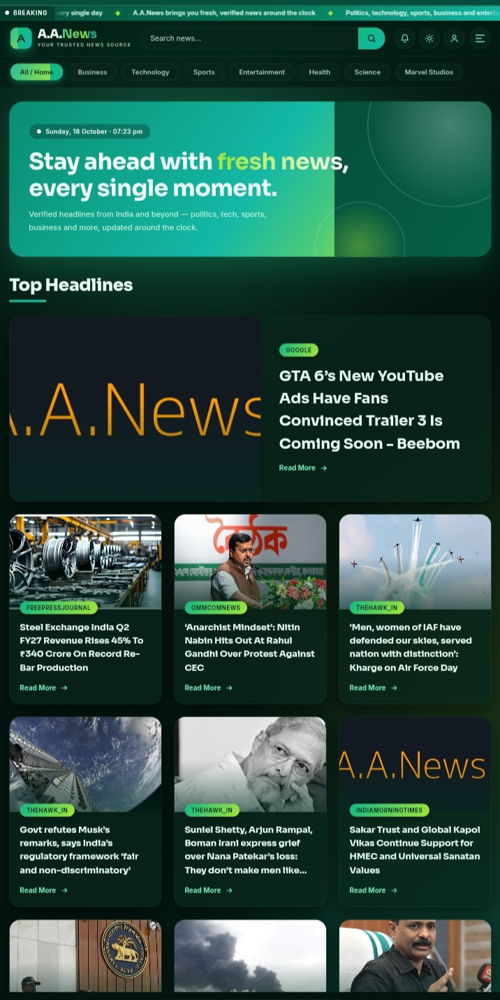
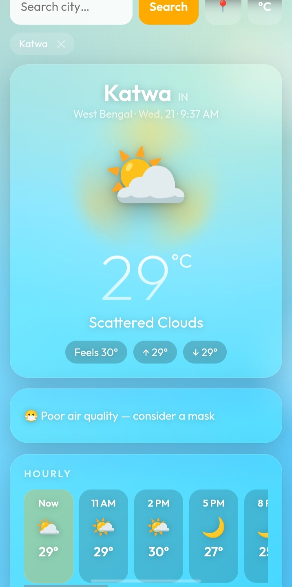
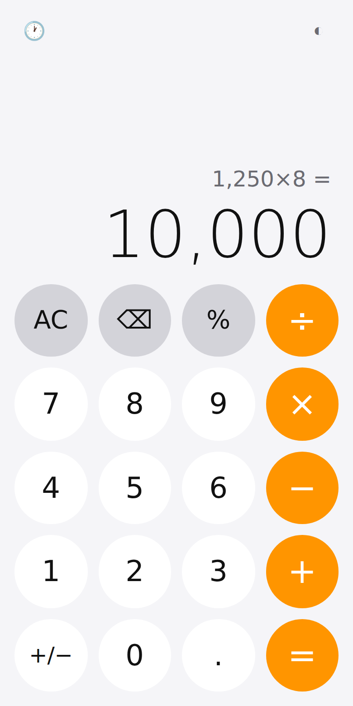
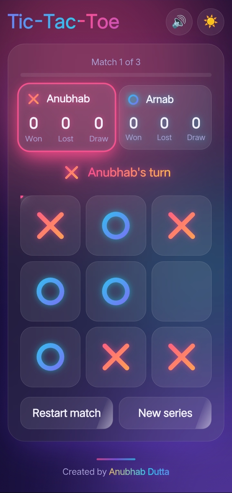
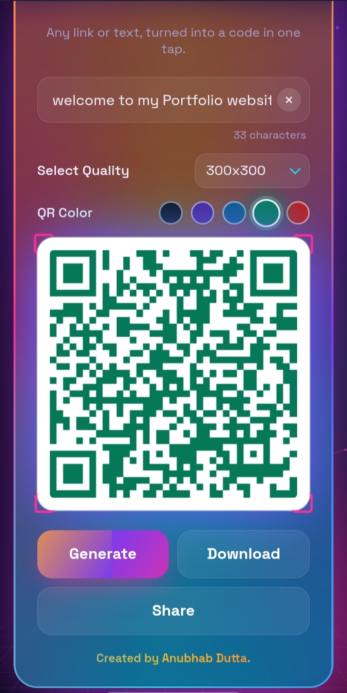
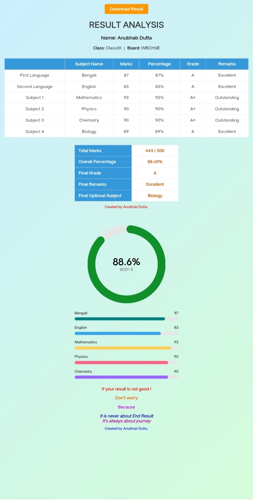
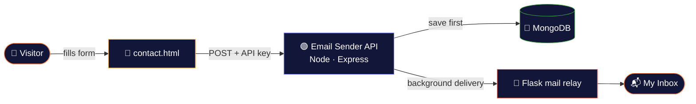

<div align="center">


<a href="https://duttaanubhab777-code.github.io/My-Portfolio/">
  
</a>

<br/>

<a href="https://duttaanubhab777-code.github.io/My-Portfolio/"></a>
<a href="https://github.com/duttaanubhab777-code"></a>
<a href="https://duttaanubhab777-code.github.io/My-Portfolio/contact.html"></a>

<br/>


</div>


## 🎬 Project Gallery

<div align="center">
  
  <sub>Auto-scrolling preview of the apps showcased on the portfolio 👆</sub>
</div>


## ✨ About This Portfolio

A personal **full-stack developer** portfolio. The site itself is built with plain **HTML, CSS & JavaScript** — no frameworks, no build step — and it showcases projects across **React, Node.js/Express, MongoDB and Flask**. Dark, cyberpunk-inspired UI with a warm orange → coral → indigo gradient theme, an animated hero background, scroll-triggered reveals and interactive project cards.

<div align="center">

| 🎨 Design | ⚡ Performance | 📱 Devices | ♿ Accessibility |
|:---:|:---:|:---:|:---:|
| Neon gradients & glow | No framework, no build step | Phone → desktop | Respects `prefers-reduced-motion` |

</div>

## 🔥 Features

<table>
<tr>
<td width="50%" valign="top">

**🎭 Motion & Effects**
- ⌨️ **Animated preloader** with a typing-style flicker effect
- 🌌 **Particle network background** in the hero (pure Canvas, no libraries)
- 🎞️ **Scroll-triggered reveal animations** on every section (IntersectionObserver)
- 🖱️ **Custom cursor glow** that follows the pointer on desktop
- 🪐 **Orbiting tech badges, aurora ring & sparkles** around the hero photo

</td>
<td width="50%" valign="top">

**🧩 Interaction & UX**
- 🎯 **Animated skill rings** (conic-gradient circles that fill in on scroll)
- 🃏 **3D tilt effect** on project cards that follows the mouse
- 📊 **Scroll progress bar** pinned to the top
- 📱 **Responsive mobile navigation** with an animated hamburger menu
- ⬆️ **Back-to-top button** that appears after scrolling

</td>
</tr>
</table>


## 🛠️ Tech Stack

<div align="center">


<br/><br/>


</div>


## 📌 Projects Shown

> Every card on the site links to a **live demo** and its **GitHub source**.

### 🧱 Full-Stack (built solo)

<table>
<tr>
<td align="center" width="240">
  <a href="https://email-sender-wy5o.onrender.com"></a><br/>
  <b>📧 Email Sender</b><br/>
  <sub>React · Vite · Node.js · Express · MongoDB · JWT · Flask · PWA</sub><br/>
  <a href="https://email-sender-wy5o.onrender.com">Live</a> · <a href="https://github.com/duttaanubhab777-code/Email-Sender/tree/main">Code</a>
</td>
<td valign="top">

**Form-to-inbox API** — a self-built alternative to Web3Forms/Formspree, and the engine behind this portfolio's contact page.

- Messages are saved first and delivered in the background
- Failed sends are retried automatically
- Auth, honeypot bot-protection and server-side API-key checks

</td>
</tr>
</table>

### 🤝 Collaborations (frontend by me · backend by [Arnab Adhikari](https://github.com/arnabadhikari777))

<div align="center">
<table>
<tr>
<td align="center" width="33%">
  <a href="https://duttaanubhab777-code.github.io/Friendly-Flux/frontend/"></a><br/>
  <b>🧪 Friendly Flux</b><br/><sub>STEM solver · Flask · SymPy · Gemini OCR</sub><br/>
  <a href="https://duttaanubhab777-code.github.io/Friendly-Flux/frontend/">Live</a> · <a href="https://github.com/duttaanubhab777-code/Friendly-Flux/tree/main">Code</a>
</td>
<td align="center" width="33%">
  <a href="https://anubhabdutta.pythonanywhere.com"></a><br/>
  <b>🤖 Beyonder AI</b><br/><sub>Chat AI · Flask · SQLite · PWA</sub><br/>
  <a href="https://anubhabdutta.pythonanywhere.com">Live</a> · <a href="https://github.com/duttaanubhab777-code/Beyonder-Ai-2.0/tree/main">Code</a>
</td>
<td align="center" width="33%">
  <a href="https://arnabadhikari125117y.pythonanywhere.com/"></a><br/>
  <b>📰 AA News</b><br/><sub>News platform · Flask · SQLite</sub><br/>
  <a href="https://arnabadhikari125117y.pythonanywhere.com/">Live</a> · <a href="https://github.com/arnabadhikari777/AA_News/tree/main">Code</a>
</td>
</tr>
</table>
</div>

### 🚀 My Projects

<div align="center">
<table>
<tr>
<td align="center" width="33%">
  <a href="https://duttaanubhab777-code.github.io/Live-Weather-App/"></a><br/>
  <b>⛅ Weather App</b><br/><sub>HTML · CSS · JavaScript</sub><br/>
  <a href="https://duttaanubhab777-code.github.io/Live-Weather-App/">Live</a> · <a href="https://github.com/duttaanubhab777-code/Live-Weather-App/tree/main">Code</a>
</td>
<td align="center" width="33%">
  <a href="https://duttaanubhab777-code.github.io/Calculator/"></a><br/>
  <b>🧮 Calculator</b><br/><sub>HTML · CSS · JavaScript</sub><br/>
  <a href="https://duttaanubhab777-code.github.io/Calculator/">Live</a> · <a href="https://github.com/duttaanubhab777-code/Calculator/tree/main">Code</a>
</td>
<td align="center" width="33%">
  <a href="https://duttaanubhab777-code.github.io/Tic-Tac-Toe/"></a><br/>
  <b>⭕ Tic-Tac-Toe</b><br/><sub>HTML · CSS · JavaScript · PWA</sub><br/>
  <a href="https://duttaanubhab777-code.github.io/Tic-Tac-Toe/">Live</a> · <a href="https://github.com/duttaanubhab777-code/Tic-Tac-Toe/tree/main">Code</a>
</td>
</tr>
<tr>
<td align="center">
  <a href="https://duttaanubhab777-code.github.io/QR-Code-Generator/"></a><br/>
  <b>🔳 QR Code Generator</b><br/><sub>HTML · CSS · JavaScript</sub><br/>
  <a href="https://duttaanubhab777-code.github.io/QR-Code-Generator/">Live</a> · <a href="https://github.com/duttaanubhab777-code/QR-Code-Generator/tree/main">Code</a>
</td>
<td align="center">
  <a href="https://duttaanubhab777-code.github.io/Result-Analysis/"></a><br/>
  <b>📊 Result Analysis</b><br/><sub>HTML · CSS · JavaScript</sub><br/>
  <a href="https://duttaanubhab777-code.github.io/Result-Analysis/">Live</a> · <a href="https://github.com/duttaanubhab777-code/Result-Analysis/tree/main">Code</a>
</td>
<td></td>
</tr>
</table>
</div>


## 📈 Live GitHub Stats

<sub>These cards update automatically — no manual editing needed.</sub>

<div align="center">


</div>


## 🗂️ Project Structure

```text
My-Portfolio/
├── 📄 index.html      # Home page — hero, skills, projects, footer
├── 📄 contact.html    # Contact page — form posts to my Email Sender API
├── 🎨 style.css       # All styling & animations
├── ⚙️ script.js       # Preloader, scroll reveals, particles, tilt effect, nav
├── 🗃️ projects.js     # All project data — add a card by adding one block here
├── 🖼️ image/          # Project screenshots & profile picture
├── ✨ assets/         # Animated SVGs used by this README
└── 📘 README.md
```

> 💡 **Add a new project:** open `projects.js` and add a block to the `PROJECTS` array — no HTML changes needed.
> No `team` → *My Projects* · `team: [...]` → *Collaborations* · `type: "fullstack"` → *Full-Stack*.

## 🔌 How the Contact Form Works



- 💾 The message is saved first and delivered in the background, so it is never lost even if the server is asleep
- 🔁 Failed sends are retried automatically; a unique `submissionId` prevents duplicate emails
- 🍯 A hidden honeypot field blocks simple bots, and the API key is checked on the server
- 🔗 The full page URL is included in the email so I know where each message came from

## 🚀 Running Locally

No build tools needed — it's static HTML/CSS/JS.

```bash
# 1. Clone the repository
git clone https://github.com/duttaanubhab777-code/My-Portfolio.git
cd My-Portfolio

# 2. Open index.html directly in a browser, or serve it locally
npx serve .

# 3. Visit the printed local URL
```


## 📬 Let's Connect

<div align="center">

<a href="https://duttaanubhab777-code.github.io/My-Portfolio/contact.html"></a>
<a href="https://github.com/duttaanubhab777-code"></a>

<br/><br/>


## 📄 License

Free to use as a reference or starting point for your own portfolio.


</div>
