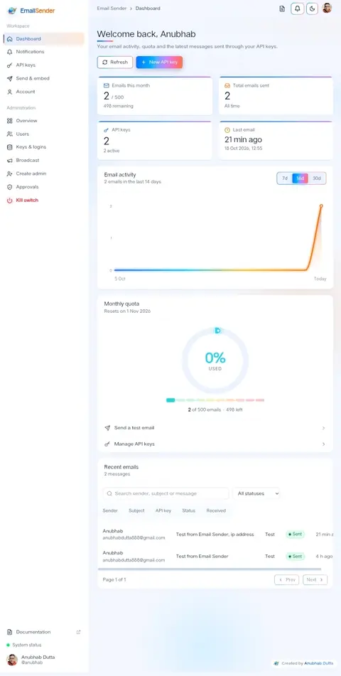
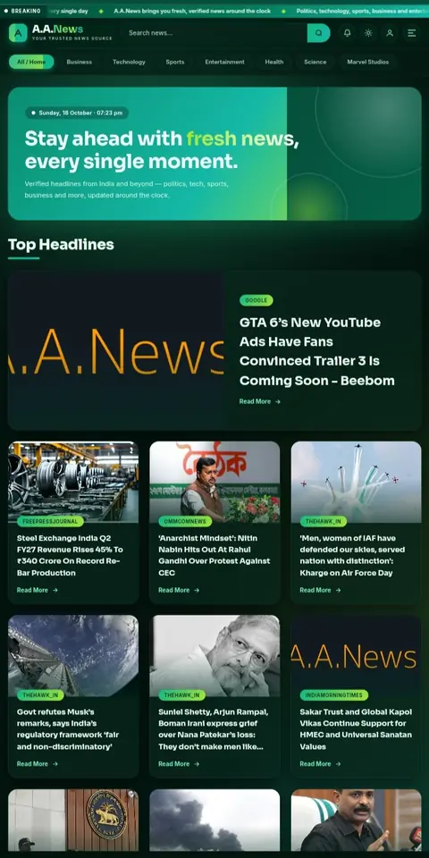
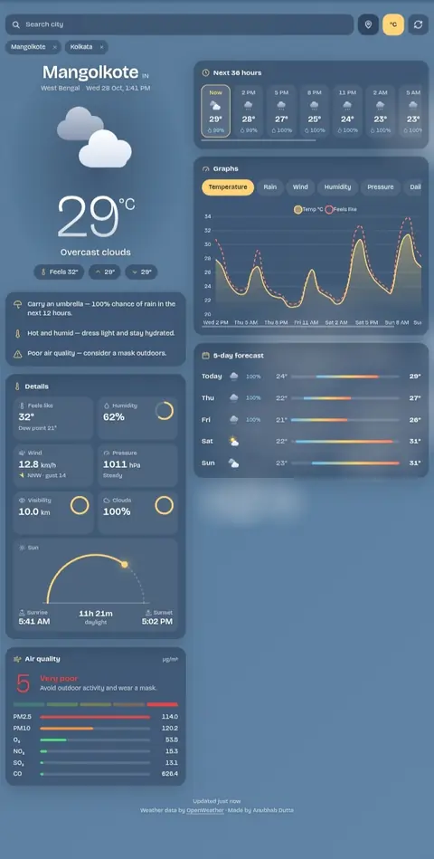
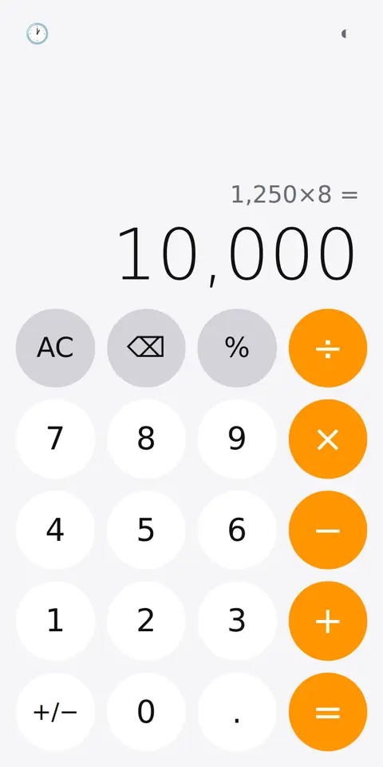
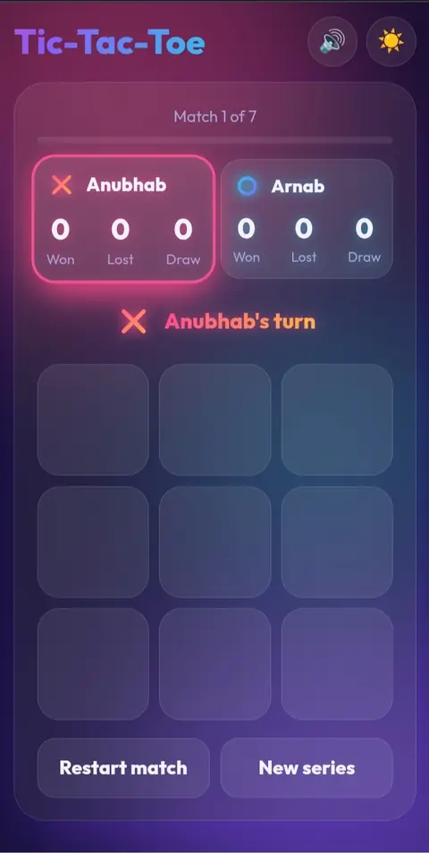
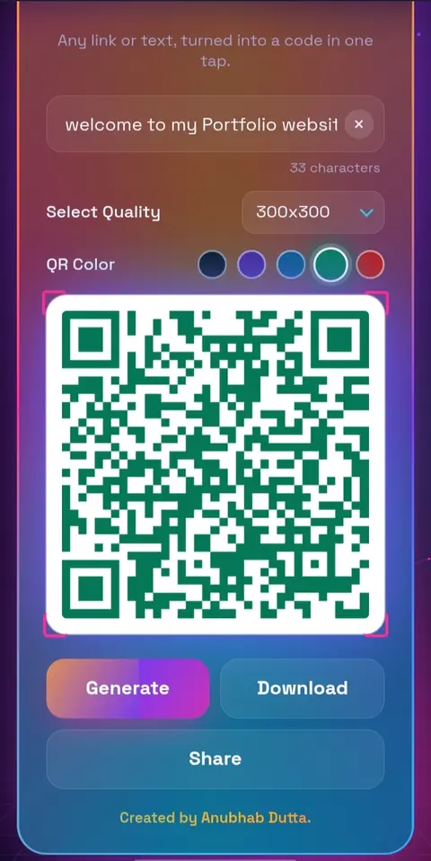
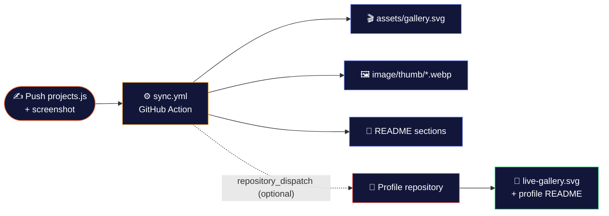
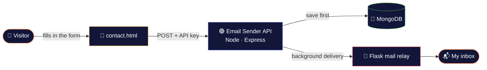

<div align="center">




<a href="https://duttaanubhab777-code.github.io/My-Portfolio/">
  
</a>

<br/>

<a href="https://duttaanubhab777-code.github.io/My-Portfolio/"></a>
<a href="https://github.com/duttaanubhab777-code"></a>
<a href="https://duttaanubhab777-code.github.io/My-Portfolio/contact.html"></a>

<br/>


<br/><br/>

<!-- COUNTS:START -->
    
<!-- COUNTS:END -->

</div>


## 🎬 Project Gallery

<div align="center">
  
  <sub>Auto-scrolling preview of every project on the portfolio. Generated from <code>projects.js</code> and the screenshots in <code>image/</code>.</sub>
</div>


## ✨ About This Portfolio

A personal **full-stack developer** portfolio built with plain **HTML, CSS and JavaScript** — no frameworks and no build step for the site itself. It showcases projects across **React, Node.js/Express, MongoDB and Flask**, with a dark, cyberpunk-inspired interface, a warm orange → coral → indigo gradient theme, an animated hero, scroll-triggered reveals and interactive project cards.

<div align="center">

|        🎨 Design         |         ⚡ Performance          |        📱 Devices         |          ♿ Accessibility          |
| :----------------------: | :-----------------------------: | :-----------------------: | :--------------------------------: |
| Gradients & glow effects | Lightweight thumbnails, no libs | Phone-first, scales to PC | Honors `prefers-reduced-motion`    |

</div>

## 🔥 Features

<table>
<tr>
<td width="50%" valign="top">

**🎭 Motion & Effects**

- ⌨️ **Animated preloader** with a typing-style flicker effect
- 🌌 **Particle network background** in the hero (pure Canvas, no libraries)
- 🎞️ **Scroll-triggered reveal animations** on every section (IntersectionObserver)
- 🖱️ **Cursor glow** that follows the pointer on desktop
- 🪐 **Orbiting tech badges, aurora ring and sparkles** around the hero photo

</td>
<td width="50%" valign="top">

**🧩 Interaction & UX**

- 🎯 **Animated skill rings** (conic-gradient circles that fill in on scroll)
- 🃏 **3D tilt effect** on project cards that follows the pointer
- 🔎 **Lightbox** for full-size screenshots and an animated **Read more** panel on every card
- 📊 **Scroll progress bar** and a **back-to-top** button
- 📱 **Responsive navigation** with an animated hamburger menu

</td>
</tr>
</table>


## 🛠️ Tech Stack

<div align="center">


<br/><br/>

<sub>Technologies used across the projects below — generated automatically, ordered by how often they appear.</sub>

<br/>

<!-- TECH:START -->


<!-- TECH:END -->

</div>


## 📌 Projects

> Every card on the site links to a **live demo** and its **GitHub source**. This section is generated from `projects.js` — do not edit it by hand.

<!-- PROJECTS:START -->
### 🧱 Full-Stack (built solo)

<div align="center">
<table>
<tr>
<td align="center" width="33%" valign="top">
  <a href="https://email-sender-wy5o.onrender.com"></a><br/>
  <b>📧 Email Sender</b><br/><sub>React · Vite · Node.js · Express · MongoDB</sub><br/>
  <a href="https://email-sender-wy5o.onrender.com">Live</a> · <a href="https://github.com/duttaanubhab777-code/Email-Sender/tree/main">Code</a>
</td>
<td></td>
<td></td>
</tr>
</table>
</div>

### 🤝 Collaborations

<div align="center">
<table>
<tr>
<td align="center" width="33%" valign="top">
  <a href="https://duttaanubhab777-code.github.io/Friendly-Flux/frontend/"></a><br/>
  <b>🧪 Friendly Flux</b><br/><sub>HTML · CSS · JavaScript · Python · Flask</sub><br/>
  <a href="https://duttaanubhab777-code.github.io/Friendly-Flux/frontend/">Live</a> · <a href="https://github.com/duttaanubhab777-code/Friendly-Flux/tree/main">Code</a>
</td>
<td align="center" width="33%" valign="top">
  <a href="https://anubhabdutta.pythonanywhere.com"></a><br/>
  <b>🤖 Beyonder Ai</b><br/><sub>HTML · CSS · JavaScript · Jinja2 · Python</sub><br/>
  <a href="https://anubhabdutta.pythonanywhere.com">Live</a> · <a href="https://github.com/duttaanubhab777-code/Beyonder-Ai-2.0/tree/main">Code</a>
</td>
<td align="center" width="33%" valign="top">
  <a href="https://arnabadhikari125117y.pythonanywhere.com/"></a><br/>
  <b>📰 AA News</b><br/><sub>HTML · CSS · JavaScript · Jinja2 · Python</sub><br/>
  <a href="https://arnabadhikari125117y.pythonanywhere.com/">Live</a> · <a href="https://github.com/arnabadhikari777/AA_News/tree/main">Code</a>
</td>
</tr>
</table>
</div>

### 🚀 My Projects

<div align="center">
<table>
<tr>
<td align="center" width="33%" valign="top">
  <a href="https://live-weather-app-gamma-inky.vercel.app/"></a><br/>
  <b>⛅ Weather App</b><br/><sub>HTML · CSS · JavaScript</sub><br/>
  <a href="https://live-weather-app-gamma-inky.vercel.app/">Live</a> · <a href="https://github.com/duttaanubhab777-code/Live-Weather-App/tree/main">Code</a>
</td>
<td align="center" width="33%" valign="top">
  <a href="https://duttaanubhab777-code.github.io/Calculator/"></a><br/>
  <b>🧮 Calculator</b><br/><sub>HTML · CSS · JavaScript</sub><br/>
  <a href="https://duttaanubhab777-code.github.io/Calculator/">Live</a> · <a href="https://github.com/duttaanubhab777-code/Calculator/tree/main">Code</a>
</td>
<td align="center" width="33%" valign="top">
  <a href="https://duttaanubhab777-code.github.io/Tic-Tac-Toe/"></a><br/>
  <b>⭕ Tic-Tac-Toe</b><br/><sub>HTML · CSS · JavaScript · PWA</sub><br/>
  <a href="https://duttaanubhab777-code.github.io/Tic-Tac-Toe/">Live</a> · <a href="https://github.com/duttaanubhab777-code/Tic-Tac-Toe/tree/main">Code</a>
</td>
</tr>
<tr>
<td align="center" width="33%" valign="top">
  <a href="https://duttaanubhab777-code.github.io/QR-Code-Generator/"></a><br/>
  <b>🔳 QR Code Generator</b><br/><sub>HTML · CSS · JavaScript</sub><br/>
  <a href="https://duttaanubhab777-code.github.io/QR-Code-Generator/">Live</a> · <a href="https://github.com/duttaanubhab777-code/QR-Code-Generator/tree/main">Code</a>
</td>
<td align="center" width="33%" valign="top">
  <a href="https://duttaanubhab777-code.github.io/Result-Analysis/"></a><br/>
  <b>📊 Result Analysis</b><br/><sub>HTML · CSS · JavaScript</sub><br/>
  <a href="https://duttaanubhab777-code.github.io/Result-Analysis/">Live</a> · <a href="https://github.com/duttaanubhab777-code/Result-Analysis/tree/main">Code</a>
</td>
<td></td>
</tr>
</table>
</div>
<!-- PROJECTS:END -->


## 📈 Live GitHub Activity

<div align="center">


<sub>⏱ Rendered by the profile repository and refreshed every 15 minutes from real GitHub API data.</sub>

<br/><br/>


</div>


## 🤖 Automation

Adding a project is a two-step job — the rest is handled by GitHub Actions.

1. Add one block to the `PROJECTS` array in [`projects.js`](projects.js).
2. Put the screenshot in [`image/`](image/).



| Generated output | Used by | How it is produced |
| --- | --- | --- |
| `assets/gallery.svg` | This README | Screenshots embedded as compressed images in an animated SVG |
| `image/thumb/*.webp` | The website | 480 px WebP versions so project cards load fast on phones |
| `COUNTS`, `TECH`, `PROJECTS` blocks | This README | Rewritten between the `<!-- NAME:START -->` / `<!-- NAME:END -->` markers |
| Gallery and tables on the GitHub profile | Profile README | The profile repository reads `projects.js` and the screenshots from this repository over HTTPS, so no images are stored there |

Optional project fields: `gallery: false` (hide from the gallery), `emoji: "🧪"` (README icon), `fallback: "https://…"` (backup screenshot URL).

## 🗂️ Project Structure

```text
My-Portfolio/
├── 📄 index.html            # Home page: hero, skills, projects, footer
├── 📄 contact.html          # Contact page: the form posts to my Email Sender API
├── 🎨 style.css             # All styling and animations
├── ⚙️ script.js             # Preloader, reveals, particles, tilt effect, navigation
├── 🗃️ projects.js           # Single source of truth for every project
├── 🖼️ image/                # Screenshots and profile picture
│   └── thumb/               #   auto-generated WebP thumbnails
├── ✨ assets/               # Banner, divider and the auto-generated gallery SVG
├── 🛠️ scripts/
│   └── build_gallery.py     # Builds the gallery, thumbnails and README sections
├── 🤖 .github/workflows/
│   └── sync.yml             # Runs the build script on every relevant push
└── 📘 README.md
```

## 🔌 How the Contact Form Works



- 💾 The message is saved first and delivered in the background, so it is never lost, even if the server is asleep
- 🔁 Failed sends are retried automatically; a unique `submissionId` prevents duplicate emails
- 🍯 A hidden honeypot field blocks simple bots, and the API key is verified on the server
- 🔗 The full page URL is included in each email so I know where the message came from

## 🚀 Running Locally

The site is static HTML, CSS and JavaScript — no build tools are required.

```bash
# 1. Clone the repository
git clone https://github.com/duttaanubhab777-code/My-Portfolio.git
cd My-Portfolio

# 2. Open index.html in a browser, or serve it locally
npx serve .

# 3. (Optional) Regenerate the gallery, thumbnails and README sections
pip install pillow
python scripts/build_gallery.py --mode portfolio
```


## 📬 Let's Connect

<div align="center">

<a href="https://duttaanubhab777-code.github.io/My-Portfolio/contact.html"></a>
<a href="https://github.com/duttaanubhab777-code"></a>

<br/><br/>


<sub>📄 Free to use as a reference or starting point for your own portfolio.</sub>


</div>
